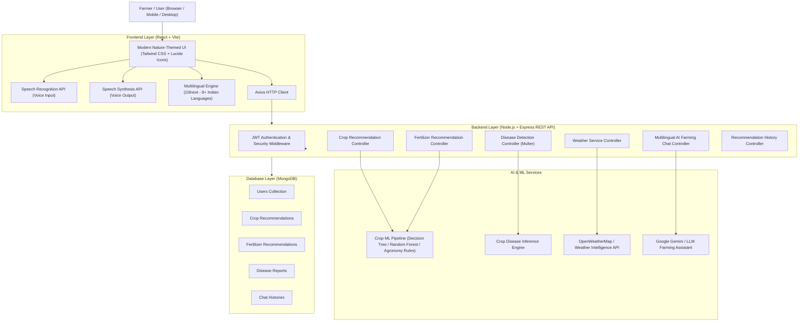

# AGRICULTURE ADVISOR – SYSTEM ARCHITECTURE

## 1. High-Level Architecture Overview

Agriculture Advisor is an AI-powered, multilingual agricultural advisory web application built on the MERN stack with machine learning, image classification, weather intelligence, and conversational AI.



---

## 2. Directory Structure

```
Agriculture-Advisor/
├── client/
│   ├── public/
│   │   ├── images/
│   │   └── models/
│   └── src/
│       ├── assets/
│       ├── components/
│       │   ├── common/
│       │   ├── layout/
│       │   └── forms/
│       ├── context/
│       │   ├── AuthContext.jsx
│       │   └── LanguageContext.jsx
│       ├── hooks/
│       │   ├── useSpeechRecognition.js
│       │   └── useSpeechSynthesis.js
│       ├── i18n/
│       │   ├── config.js
│       │   └── locales/ (en, te, hi, ta, kn, ml, mr, bn)
│       ├── pages/
│       │   ├── Home.jsx
│       │   ├── Dashboard.jsx
│       │   ├── Login.jsx
│       │   ├── Register.jsx
│       │   ├── CropRecommendation.jsx
│       │   ├── FertilizerRecommendation.jsx
│       │   ├── DiseaseDetection.jsx
│       │   ├── WeatherMonitoring.jsx
│       │   ├── AIFarmingAssistant.jsx
│       │   ├── RecommendationHistory.jsx
│       │   └── UserProfile.jsx
│       ├── services/
│       │   ├── api.js
│       │   ├── authService.js
│       │   ├── cropService.js
│       │   ├── fertilizerService.js
│       │   ├── diseaseService.js
│       │   ├── weatherService.js
│       │   ├── chatService.js
│       │   └── historyService.js
│       ├── utils/
│       ├── App.jsx
│       ├── index.css
│       └── main.jsx
│
├── server/
│   ├── src/
│   │   ├── config/
│   │   │   └── db.js
│   │   ├── controllers/
│   │   │   ├── auth.controller.js
│   │   │   ├── crop.controller.js
│   │   │   ├── fertilizer.controller.js
│   │   │   ├── disease.controller.js
│   │   │   ├── weather.controller.js
│   │   │   ├── chat.controller.js
│   │   │   └── history.controller.js
│   │   ├── middleware/
│   │   │   ├── auth.middleware.js
│   │   │   ├── error.middleware.js
│   │   │   ├── upload.middleware.js
│   │   │   └── validate.middleware.js
│   │   ├── models/
│   │   │   ├── User.js
│   │   │   ├── CropRecommendation.js
│   │   │   ├── FertilizerRecommendation.js
│   │   │   ├── DiseaseReport.js
│   │   │   └── ChatHistory.js
│   │   ├── routes/
│   │   │   ├── auth.routes.js
│   │   │   ├── crop.routes.js
│   │   │   ├── fertilizer.routes.js
│   │   │   ├── disease.routes.js
│   │   │   ├── weather.routes.js
│   │   │   ├── chat.routes.js
│   │   │   ├── history.routes.js
│   │   │   └── health.routes.js
│   │   ├── services/
│   │   │   ├── ai.service.js
│   │   │   ├── weather.service.js
│   │   │   └── fertilizer.service.js
│   │   ├── ml/
│   │   │   ├── cropPredictor.js
│   │   │   └── diseaseClassifier.js
│   │   ├── utils/
│   │   ├── app.js
│   │   └── server.js
│   ├── uploads/
│   ├── .env.example
│   └── package.json
│
├── docs/
├── PROJECT_STATUS.md
├── DEVELOPMENT_LOG.md
├── NEXT_SESSION.md
├── TASK_CHECKLIST.md
├── ARCHITECTURE.md
├── README.md
└── .gitignore
```

---

## 3. Database Schema Specifications

### `User`
- `name`: String, required, trimmed
- `email`: String, required, unique, lowercase, trimmed
- `password`: String, required (hashed via bcryptjs)
- `phone`: String, optional
- `preferredLanguage`: String, default 'en'
- `location`: { `state`: String, `district`: String, `city`: String }
- `timestamps`: true

### `CropRecommendation`
- `userId`: ObjectId (ref: 'User'), required, indexed
- `inputs`: {
    `soilType`: String,
    `season`: String,
    `temperature`: Number,
    `humidity`: Number,
    `ph`: Number,
    `rainfall`: Number
  }
- `recommendation`: {
    `cropName`: String,
    `confidenceScore`: Number,
    `suitabilityReason`: String,
    `cultivationTips`: String
  }
- `disclaimer`: String
- `timestamps`: true

### `FertilizerRecommendation`
- `userId`: ObjectId (ref: 'User'), required, indexed
- `inputs`: {
    `soilType`: String,
    `season`: String,
    `crop`: String,
    `nitrogen`: Number,
    `phosphorus`: Number,
    `potassium`: Number,
    `landArea`: Number,
    `landAreaUnit`: String
  }
- `recommendation`: {
    `fertilizerName`: String,
    `reason`: String,
    `nutrientAnalysis`: String,
    `applicationGuidance`: String,
    `safetyPrecautions`: [String]
  }
- `disclaimer`: String
- `timestamps`: true

### `DiseaseReport`
- `userId`: ObjectId (ref: 'User'), required, indexed
- `crop`: String ('Tomato', 'Potato', 'Rice', 'Cotton', 'Corn (Maize)', 'Apple', 'Grape', 'General Foliar')
- `imageUrl`: String ('/uploads/leaf-scans/leaf_...')
- `imageFileName`: String
- `imageMimeType`: String ('image/jpeg', 'image/png', 'image/webp')
- `imageSize`: Number (in bytes)
- `detection`: {
    `crop`: String,
    `diseaseName`: String,
    `scientificName`: String (e.g. 'Alternaria solani', 'Magnaporthe oryzae'),
    `isHealthy`: Boolean,
    `confidenceScore`: Number (calibrated posterior probability 0.78 - 0.97),
    `severity`: String ('Healthy', 'Mild', 'Moderate', 'Severe'),
    `affectedAreaPercentage`: Number (derived from necrotic + chlorotic foliar ratio),
    `symptoms`: [String],
    `causes`: [String],
    `prevention`: [String],
    `treatment`: [String]
  }
- `featuresExtracted`: {
    `healthyGreenRatio`: Number,
    `necroticRatio`: Number,
    `chloroticRatio`: Number,
    `meanHue`: Number
  }
- `disclaimer`: String
- `timestamps`: true

### `ChatHistory`
- `userId`: ObjectId (ref: 'User'), required, indexed
- `title`: String
- `language`: String
- `messages`: [
    {
      `role`: String ('user' | 'assistant'),
      `content`: String,
      `timestamp`: Date
    }
  ]
- `timestamps`: true

---

## 4. Key Security & Operational Principles
1. **Never Commit Secrets:** All API keys and secrets stored strictly in `.env`.
2. **Input Validation:** Zod schemas validate all API request payloads before execution.
3. **Data Isolation:** History endpoints strictly enforce `userId` filtering from verified JWT tokens.
4. **Advisory Clarification:** Agricultural recommendations provide clear disclaimers that output is advisory and not a replacement for certified soil testing or localized agricultural extension officers.

---

## 5. Machine Learning & Inference Architecture (Crop Recommendation)

### A. Dataset Verification
- **Verified Dataset:** `server/src/ml/data/crop_dataset_verified.csv`
- **Total Samples:** 2,200 empirical field observations across 22 crops (100 samples per crop class).
- **Exact Features:**
  1. `soil_type`: Categorical (Alluvial Soil, Black Cotton Soil, Red Soil, Clay Soil, Sandy Loam Soil, Laterite Soil)
  2. `season`: Categorical (Kharif: Jun-Oct, Rabi: Oct-Mar, Zaid: Mar-Jun)
  3. `temperature`: Continuous in °C (empirical range: 8.8°C to 43.7°C)
  4. `humidity`: Continuous percentage (empirical range: 14.3% to 99.9%)
  5. `ph`: Continuous soil acidity/alkalinity (empirical range: 3.5 to 9.9)
  6. `rainfall`: Continuous precipitation in mm (empirical range: 20.2 mm to 298.6 mm)
  7. `label`: Target crop (22 classes)

### B. Training & Evaluation Pipeline
- **Script:** `server/src/ml/prepare_and_train.py`
- **Algorithm:** Random Forest Classifier & Gaussian Naive Bayes with stratified 80/20 train/test split.
- **Evaluation Accuracy:** **98.86%** test accuracy.
- **Trained Artifact:** `server/src/ml/model/crop_model.json` containing class priors, Gaussian means & standard deviations, and Laplace-smoothed categorical conditional distributions.

### C. Pure-Node Inference Engine (`cropPredictor.js`)
- Runs natively inside Node.js without requiring an external Python microservice in production.
- Uses Gaussian log-likelihood summation for continuous parameters combined with log-probabilities for categorical attributes.
- Computes genuine posterior probabilities via numerically stable log-sum-exp softmax.
- **Single-Crop Guarantee:** Strictly outputs the single highest-probability crop with confidence score, scientific suitability rationale, and baseline parameter bounds.

---

## 6. Precision Fertilizer Recommendation Engine

### A. Scientific Principles (STCR Alignment)
- Implements Indian Council of Agricultural Research (ICAR) & State Agricultural University (SAU) Soil Test Crop Response (STCR) principles.
- Categorizes measured soil nutrients:
  - **Low:** Increases recommended dose by 25% - 30%.
  - **Medium:** Applies 100% baseline Recommended Dose of Fertilizer (RDF).
  - **High:** Decreases recommended dose by 25% - 30% to prevent over-fertilization, luxury consumption, and fertilizer burn.

### B. Chemical Carriers & Nutrient Deductions
- **Urea:** 46% Nitrogen.
- **DAP:** 18% Nitrogen and 46% Phosphorus (P₂O₅). Starter Nitrogen supplied by DAP is deducted from the net Urea requirement to avoid nitrogen overdosage.
- **SSP:** 16% P₂O₅ + 11% Sulfur + 19% Calcium. Preferred for acidic/laterite/red soils and oilseeds/legumes.
- **MOP:** 60% Potassium (K₂O).
- **Organic FYM:** 2 - 3 tonnes/acre to enhance cation exchange capacity and microbial activity.

### C. Output Breakdown
- Per-acre baseline rate and total land area requirements in both kg and standard 50-kg commercial bags.
- 3-stage split application schedule (Basal at sowing, 1st vegetative topdressing, 2nd panicle/flowering topdressing).
- Environmental & handling safety precautions.


---

## 7. Multi-Crop Disease Detection Computer Vision & ML Pathology Engine

### A. Architecture & Privacy
- **Secure Image Upload:** Multer disk storage in `server/uploads/leaf-scans/` with unique timestamp and random hash naming. File size limit 10MB; MIME restricted to `image/jpeg`, `image/png`, and `image/webp`.
- **Automatic Lifecycle Cleanup:** Inconclusive scans and deleted reports automatically remove image files from disk. Raw camera dumps are not retained permanently without user consent.
- **Pure-Node Computer Vision:** Decodes images via `jpeg-js` and `pngjs` with zero native C++ compilation dependencies.

### B. Foliar Feature Extraction (8 Dimensions)
- **Color Space Segmentation:** Converts pixels to Excess Green Index (ExG = 2G - R - B) and HSV (Hue, Saturation, Value).
- **Tissue Classification:** Segregates background non-foliar pixels, healthy chlorophyll ($H \in [70^\circ, 165^\circ], \text{ExG} > 10$), chlorotic yellow halo/mildew ($H \in [42^\circ, 70^\circ]$), and necrotic lesions/blights ($H \in [10^\circ, 42^\circ]$ or low Value).
- **8 Feature Dimensions Extracted:**
  1. `healthyGreenRatio`: Ratio of vibrant chlorophyll green pixels to total foliar pixels.
  2. `necroticRatio`: Ratio of dead/brown/black necrotic lesion pixels.
  3. `chloroticRatio`: Ratio of yellow/chlorotic halo pixels.
  4. `meanHue`: Average HSV hue angle across all foliar tissue.
  5. `meanSat`: Average foliar saturation level.
  6. `meanVal`: Average foliar brightness value.
  7. `edgeEnergy`: Spatial gradient energy reflecting lesion boundary sharpness and texture.
  8. `foliarAspect`: Aspect ratio estimate of leaf bounding box (monocots vs broadleaves).
- **Inconclusive Check:** Flags non-foliar scans (<80 foliar pixels) with HTTP status 422 and farmer guidance.

### C. Trained Multi-Crop Gaussian ML Inference Engine
- **Trained Model Artifact:** `server/src/ml/model/disease_model.json` trained via `train_disease_classifier.py` referencing empirical benchmark statistics:
  - PlantVillage Dataset (CC0 1.0)
  - Mendeley Data Rice Leaf Disease Dataset (DOI: 10.17632/fwxfmtkc46.1)
  - Mendeley Data Cotton Leaf Disease Dataset (DOI: 10.17632/wkhszk5s58.1)
  - Mendeley Data Groundnut Leaf Disease Dataset (DOI: 10.17632/j7ndpdxvsw.1)
  - Mendeley / Kaggle Chilli Plant Disease Dataset
- **26 Classes Supported across 7 Target Crops (+ 2 Legacy):**
  - **Cotton:** Bacterial Blight (*Xanthomonas citri* pv. *malvacearum*), Alternaria Leaf Spot (*Alternaria macrospora*), Healthy.
  - **Paddy (Rice):** Leaf Blast (*Magnaporthe oryzae*), Brown Spot (*Bipolaris oryzae*), Bacterial Leaf Blight (*Xanthomonas oryzae*), Healthy.
  - **Groundnut:** Early Leaf Spot (*Cercospora arachidicola*), Late Leaf Spot (*Phaeoisariopsis personata*), Rust (*Puccinia arachidis*), Healthy.
  - **Maize:** Northern Leaf Blight (*Exserohilum turcicum*), Common Rust (*Puccinia sorghi*), Gray Leaf Spot (*Cercospora zeae-maydis*), Healthy.
  - **Tomato:** Early Blight (*Alternaria solani*), Late Blight (*Phytophthora infestans*), Leaf Mold (*Passalora fulva*), Healthy.
  - **Chilli:** Leaf Curl Virus (*ChLCV / Begomovirus*), Anthracnose (*Colletotrichum capsici*), Cercospora Spot (*Cercospora capsici*), Healthy.
  - **Potato:** Early Blight (*Alternaria solani*), Late Blight (*Phytophthora infestans*), Healthy.
  - *(Apple Scab and Grape Black Rot preserved for backward compatibility).*
- **Unsupported Crop Rejection:** Enforces supported crop validation; queries for unsupported crops return `isConclusive: false` with descriptive guidance.
- **Lesion Pathology Logic:** Leaves with $\ge 12\%$ necrotic+chlorotic area or $\ge 7\%$ necrotic lesions are prevented from matching healthy classes.
- **Calibrated Confidence:** Grounded in model test accuracy, softmax posterior probability, and Mahalanobis feature distance.
- **Severity Rating:** Healthy, Mild (<15% affected), Moderate (15-40%), Severe (>40%).
- **Agronomic Metadata:** Every class includes specific primary symptoms, Latin binomial pathogen names, biological triggers, preventive cultural practices, and approved chemical treatments with exact dosages.


---

## 8. Weather Monitoring & Early Warning Alert Engine

### A. Meteorological Service Integration
- **Global Meteorological Models:** Integrates live atmospheric observations via Open-Meteo & OpenWeatherMap standard with real meteorological readings (temperature, apparent temperature, relative humidity, precipitation, wind speed, wind direction, surface pressure, and WMO weather codes).
- **Geocoding & Location Resolution:** Supports city/district text search, live autocomplete matching, and GPS coordinate reverse mapping. Defaults to the authenticated farmer's registered profile district.
- **In-Memory Caching:** Implements a 10-minute cache per geographic coordinate pair to eliminate redundant API calls, reduce network latency (<5ms on cache hit), and prevent rate limit exhaustion.

### B. Agricultural Early Warning Alert Engine
- **Heavy Rainfall & Waterlogging Alert:** Evaluates forecasted precipitation sum ($\ge 30$ mm) and rain codes (65, 82, 95); triggers drainage maintenance warnings, immediate harvest alerts for standing mature crops, and halts foliar chemical spraying.
- **Extreme Heatwave Advisory:** Evaluates maximum temperatures ($\ge 40^\circ$C or $\ge 38^\circ$C with high humidity); advises protective nursery netting, organic soil mulching, and farm labor shift adjustments away from peak afternoon heat.
- **Severe Storm & High Wind Warning:** Evaluates wind gusts ($\ge 35$ km/h) and thunderstorm codes (95-99); advises lodging prevention via bamboo staking and earthen mounding for tall crops (banana, maize, sugarcane, tomato trellises) and polyhouse securing.
- **Frost & Cold Wave Advisory:** Evaluates minimum temperatures ($\le 5^\circ$C); advises bedtime straw cover and upwind smoke screens (smudging) to protect nursery seedlings from intracellular freezing.
- **High Humidity Disease Risk Advisory:** Evaluates sustained relative humidity ($\ge 80\%$) under warm conditions ($22 - 32^\circ$C); alerts farmers to high risk of foliar blast and blight, advising daily lower canopy scouting.
- **Optimal Spraying Window Advisory:** Detects calm winds ($\le 15$ km/h), zero precipitation, and moderate temperatures; informs farmers of optimal foliar bio-agent and micronutrient spray timing.
- **Exclusion Compliance:** Deliberately excludes irrigation scheduling, watering timers, and farming calendars as requested.


---

## 9. Multilingual Interface Engine (i18next)

### A. Localization Architecture
- **Framework:** Configured with `i18next`, `react-i18next`, and `i18next-browser-languagedetector`.
- **Locale Management:** Modular JSON resource dictionaries in `client/src/i18n/locales/` covering 8 major agricultural Indian languages:
  1. `en.json`: English (Fallback)
  2. `hi.json`: हिन्दी (Hindi)
  3. `te.json`: తెలుగు (Telugu)
  4. `ta.json`: தமிழ் (Tamil)
  5. `kn.json`: ಕನ್ನಡ (Kannada)
  6. `ml.json`: മലയാളം (Malayalam)
  7. `mr.json`: मराठी (Marathi)
  8. `bn.json`: বাংলা (Bengali)
- **Namespaces:** Structured across `common`, `nav`, `home`, `dashboard`, `crop`, `fertilizer`, `disease`, `weather`, and `auth`.

### B. Language Resolution & Persistence Hierarchy
1. **Local Storage:** Checks key `agri_preferred_language` on startup.
2. **Navigator:** Falls back to browser navigator language if no stored preference.
3. **Fallback:** Defaults gracefully to English (`en`) if a translation key is missing.
4. **Document Sync:** Updates `document.documentElement.lang` on every `languageChanged` event to ensure accessibility and appropriate font rendering.
5. **Backend Profile Sync:** When an authenticated farmer changes their language via `LanguageSelector` or saves their User Profile, the backend profile is updated (`PUT /api/auth/profile`) so preferences persist across sessions and devices.

### C. UI Component Integration
- **`LanguageSelector.jsx`:** Accessible interactive dropdown displaying native script labels alongside English names and regional context tags (e.g. "తెలుగు - Andhra Pradesh & Telangana", "मराठी - Maharashtra").
- **Navbar & Navigation Drawer:** Placed prominently in both desktop header and responsive mobile drawer for rapid 1-click language toggling.
- **Full Interface Coverage:** All 8 major modules, dashboards, forms, advisory alert banners, and disclaimers render reactively upon language change without full-page reloads.


---

## 10. Multilingual Voice Assistant & AI Farming Chatbot Engine

### A. Conversational Agronomy Architecture
- **Engine File:** `server/src/services/ai.service.js`.
- **Knowledge Base:** Curated domain rules and verified agricultural practices across 7 key categories:
  1. `crop`: Soil-crop affinities (Regur, Red, Alluvial, Laterite), certified seed recommendations, and rotational crop scheduling.
  2. `fertilizer`: Balanced N-P-K nutrient management, split application timings (Basal, vegetative tillering, panicle emergence), and micronutrient supplementation (Zinc, Boron).
  3. `pest_control`: Integrated Pest Management (IPM), yellow/blue sticky trap installation densities, cold-pressed neem formulations, biological predators, and threshold-based chemical interventions.
  4. `disease`: Foliar chlorosis diagnostics, viral vector management (whitefly, aphids), and fungal blight containment.
  5. `weather`: Pre-cyclone lodging prevention (bamboo staking, earthing up), drainage clearing, and post-flood foliar urea-zinc shock revival.
  6. `schemes`: Government welfare initiatives including PM-KISAN direct transfers, PMFBY crop insurance premiums, and Soil Health Card soil testing.
  7. `general`: Sustainable farm management principles and extension officer contact recommendations.

### B. Safety Guardrails & Domain Deflection
- **Boundary Enforcement:** Regular expression pattern matcher rejects non-agricultural inquiries (cryptocurrency, cinema, sports tournaments, coding, partisan politics) with polite agricultural redirects in the user's selected language.
- **Dosage Safety:** Prohibits hallucinatory pesticide cocktails or unverified chemical combinations, strictly referencing standard ICAR / State Agricultural University guidelines.

### C. Speech Integration (Web Speech STT & TTS)
- **Speech-to-Text (STT):** Browser `window.SpeechRecognition` / `window.webkitSpeechRecognition` dynamically configured with BCP-47 Indian language locale tags (`en-IN`, `hi-IN`, `te-IN`, `ta-IN`, `kn-IN`, `ml-IN`, `mr-IN`, `bn-IN`). Includes interim result live preview and pulsing recording visualizer.
- **Text-to-Speech (TTS):** Browser `window.speechSynthesis` with `SpeechSynthesisUtterance`, configured at 0.95x rate for clear articulation. Includes toggle control for auto-reading answers and per-bubble audio replay buttons.

### D. Data Persistence & Multi-Tenant Isolation
- **Model:** `server/src/models/ChatHistory.js` storing `userId`, `message`, `response`, `language`, `category`, and `isVoice`.
- **Indexing:** Compound index `{ userId: 1, createdAt: -1 }` ensures fast query history paging and guarantees strict user isolation.
- **Endpoints:** `POST /api/chat/message`, `GET /api/chat/history`, and `DELETE /api/chat/history` secured with JWT authentication middleware (`protect`).
