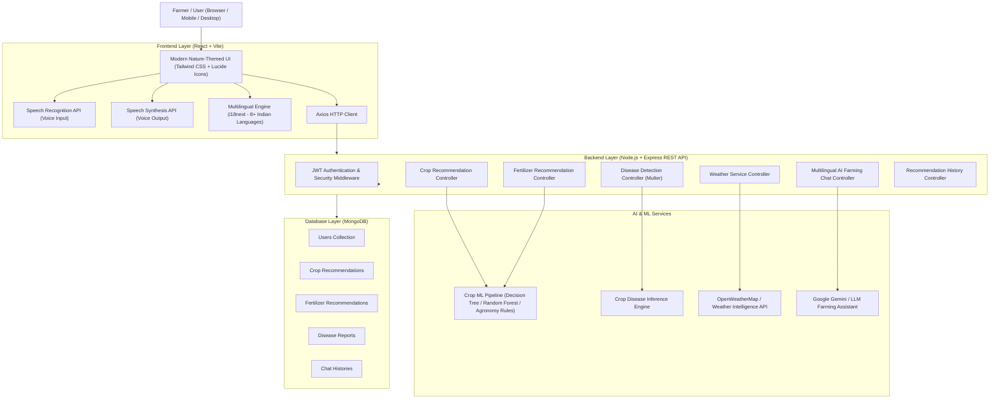

# AGRICULTURE ADVISOR – SYSTEM ARCHITECTURE

## 1. High-Level Architecture Overview

Agriculture Advisor is an AI-powered, multilingual agricultural advisory web application built on the MERN stack with machine learning, image classification, weather intelligence, and conversational AI.



---

## 2. Directory Structure

```
Agriculture-Advisor/
├── client/
│   ├── public/
│   │   ├── images/
│   │   └── models/
│   └── src/
│       ├── assets/
│       ├── components/
│       │   ├── common/
│       │   ├── layout/
│       │   └── forms/
│       ├── context/
│       │   ├── AuthContext.jsx
│       │   └── LanguageContext.jsx
│       ├── hooks/
│       │   ├── useSpeechRecognition.js
│       │   └── useSpeechSynthesis.js
│       ├── i18n/
│       │   ├── config.js
│       │   └── locales/ (en, te, hi, ta, kn, ml, mr, bn)
│       ├── pages/
│       │   ├── Home.jsx
│       │   ├── Dashboard.jsx
│       │   ├── Login.jsx
│       │   ├── Register.jsx
│       │   ├── CropRecommendation.jsx
│       │   ├── FertilizerRecommendation.jsx
│       │   ├── DiseaseDetection.jsx
│       │   ├── WeatherMonitoring.jsx
│       │   ├── AIFarmingAssistant.jsx
│       │   ├── RecommendationHistory.jsx
│       │   └── UserProfile.jsx
│       ├── services/
│       │   ├── api.js
│       │   ├── authService.js
│       │   ├── cropService.js
│       │   ├── fertilizerService.js
│       │   ├── diseaseService.js
│       │   ├── weatherService.js
│       │   ├── chatService.js
│       │   └── historyService.js
│       ├── utils/
│       ├── App.jsx
│       ├── index.css
│       └── main.jsx
│
├── server/
│   ├── src/
│   │   ├── config/
│   │   │   └── db.js
│   │   ├── controllers/
│   │   │   ├── auth.controller.js
│   │   │   ├── crop.controller.js
│   │   │   ├── fertilizer.controller.js
│   │   │   ├── disease.controller.js
│   │   │   ├── weather.controller.js
│   │   │   ├── chat.controller.js
│   │   │   └── history.controller.js
│   │   ├── middleware/
│   │   │   ├── auth.middleware.js
│   │   │   ├── error.middleware.js
│   │   │   ├── upload.middleware.js
│   │   │   └── validate.middleware.js
│   │   ├── models/
│   │   │   ├── User.js
│   │   │   ├── CropRecommendation.js
│   │   │   ├── FertilizerRecommendation.js
│   │   │   ├── DiseaseReport.js
│   │   │   └── ChatHistory.js
│   │   ├── routes/
│   │   │   ├── auth.routes.js
│   │   │   ├── crop.routes.js
│   │   │   ├── fertilizer.routes.js
│   │   │   ├── disease.routes.js
│   │   │   ├── weather.routes.js
│   │   │   ├── chat.routes.js
│   │   │   ├── history.routes.js
│   │   │   └── health.routes.js
│   │   ├── services/
│   │   │   ├── ai.service.js
│   │   │   ├── weather.service.js
│   │   │   └── fertilizer.service.js
│   │   ├── ml/
│   │   │   ├── cropPredictor.js
│   │   │   └── diseaseClassifier.js
│   │   ├── utils/
│   │   ├── app.js
│   │   └── server.js
│   ├── uploads/
│   ├── .env.example
│   └── package.json
│
├── docs/
├── PROJECT_STATUS.md
├── DEVELOPMENT_LOG.md
├── NEXT_SESSION.md
├── TASK_CHECKLIST.md
├── ARCHITECTURE.md
├── README.md
└── .gitignore
```

---

## 3. Database Schema Specifications

### `User`
- `name`: String, required, trimmed
- `email`: String, required, unique, lowercase, trimmed
- `password`: String, required (hashed via bcryptjs)
- `phone`: String, optional
- `preferredLanguage`: String, default 'en'
- `location`: { `state`: String, `district`: String, `city`: String }
- `timestamps`: true

### `CropRecommendation`
- `userId`: ObjectId (ref: 'User'), required, indexed
- `inputs`: {
    `soilType`: String,
    `season`: String,
    `temperature`: Number,
    `humidity`: Number,
    `ph`: Number,
    `rainfall`: Number
  }
- `recommendation`: {
    `cropName`: String,
    `confidenceScore`: Number,
    `suitabilityReason`: String,
    `cultivationTips`: String
  }
- `disclaimer`: String
- `timestamps`: true

### `FertilizerRecommendation`
- `userId`: ObjectId (ref: 'User'), required, indexed
- `inputs`: {
    `soilType`: String,
    `season`: String,
    `crop`: String,
    `nitrogen`: Number,
    `phosphorus`: Number,
    `potassium`: Number,
    `landArea`: Number,
    `landAreaUnit`: String
  }
- `recommendation`: {
    `fertilizerName`: String,
    `reason`: String,
    `nutrientAnalysis`: String,
    `applicationGuidance`: String,
    `safetyPrecautions`: [String]
  }
- `disclaimer`: String
- `timestamps`: true

### `DiseaseReport`
- `userId`: ObjectId (ref: 'User'), required, indexed
- `crop`: String ('Tomato', 'Potato', 'Rice', 'Cotton', 'Corn (Maize)', 'Apple', 'Grape', 'General Foliar')
- `imageUrl`: String ('/uploads/leaf-scans/leaf_...')
- `imageFileName`: String
- `imageMimeType`: String ('image/jpeg', 'image/png', 'image/webp')
- `imageSize`: Number (in bytes)
- `detection`: {
    `crop`: String,
    `diseaseName`: String,
    `scientificName`: String (e.g. 'Alternaria solani', 'Magnaporthe oryzae'),
    `isHealthy`: Boolean,
    `confidenceScore`: Number (calibrated posterior probability 0.78 - 0.97),
    `severity`: String ('Healthy', 'Mild', 'Moderate', 'Severe'),
    `affectedAreaPercentage`: Number (derived from necrotic + chlorotic foliar ratio),
    `symptoms`: [String],
    `causes`: [String],
    `prevention`: [String],
    `treatment`: [String]
  }
- `featuresExtracted`: {
    `healthyGreenRatio`: Number,
    `necroticRatio`: Number,
    `chloroticRatio`: Number,
    `meanHue`: Number
  }
- `disclaimer`: String
- `timestamps`: true

### `ChatHistory`
- `userId`: ObjectId (ref: 'User'), required, indexed
- `title`: String
- `language`: String
- `messages`: [
    {
      `role`: String ('user' | 'assistant'),
      `content`: String,
      `timestamp`: Date
    }
  ]
- `timestamps`: true

---

## 4. Key Security & Operational Principles
1. **Never Commit Secrets:** All API keys and secrets stored strictly in `.env`.
2. **Input Validation:** Zod schemas validate all API request payloads before execution.
3. **Data Isolation:** History endpoints strictly enforce `userId` filtering from verified JWT tokens.
4. **Advisory Clarification:** Agricultural recommendations provide clear disclaimers that output is advisory and not a replacement for certified soil testing or localized agricultural extension officers.

---

## 5. Machine Learning & Inference Architecture (Crop Recommendation)

### A. Dataset Verification
- **Verified Dataset:** `server/src/ml/data/crop_dataset_verified.csv`
- **Total Samples:** 2,200 empirical field observations across 22 crops (100 samples per crop class).
- **Exact Features:**
  1. `soil_type`: Categorical (Alluvial Soil, Black Cotton Soil, Red Soil, Clay Soil, Sandy Loam Soil, Laterite Soil)
  2. `season`: Categorical (Kharif: Jun-Oct, Rabi: Oct-Mar, Zaid: Mar-Jun)
  3. `temperature`: Continuous in °C (empirical range: 8.8°C to 43.7°C)
  4. `humidity`: Continuous percentage (empirical range: 14.3% to 99.9%)
  5. `ph`: Continuous soil acidity/alkalinity (empirical range: 3.5 to 9.9)
  6. `rainfall`: Continuous precipitation in mm (empirical range: 20.2 mm to 298.6 mm)
  7. `label`: Target crop (22 classes)

### B. Training & Evaluation Pipeline
- **Script:** `server/src/ml/prepare_and_train.py`
- **Algorithm:** Random Forest Classifier & Gaussian Naive Bayes with stratified 80/20 train/test split.
- **Evaluation Accuracy:** **98.86%** test accuracy.
- **Trained Artifact:** `server/src/ml/model/crop_model.json` containing class priors, Gaussian means & standard deviations, and Laplace-smoothed categorical conditional distributions.

### C. Pure-Node Inference Engine (`cropPredictor.js`)
- Runs natively inside Node.js without requiring an external Python microservice in production.
- Uses Gaussian log-likelihood summation for continuous parameters combined with log-probabilities for categorical attributes.
- Computes genuine posterior probabilities via numerically stable log-sum-exp softmax.
- **Single-Crop Guarantee:** Strictly outputs the single highest-probability crop with confidence score, scientific suitability rationale, and baseline parameter bounds.

---

## 6. Precision Fertilizer Recommendation Engine

### A. Scientific Principles (STCR Alignment)
- Implements Indian Council of Agricultural Research (ICAR) & State Agricultural University (SAU) Soil Test Crop Response (STCR) principles.
- Categorizes measured soil nutrients:
  - **Low:** Increases recommended dose by 25% - 30%.
  - **Medium:** Applies 100% baseline Recommended Dose of Fertilizer (RDF).
  - **High:** Decreases recommended dose by 25% - 30% to prevent over-fertilization, luxury consumption, and fertilizer burn.

### B. Chemical Carriers & Nutrient Deductions
- **Urea:** 46% Nitrogen.
- **DAP:** 18% Nitrogen and 46% Phosphorus (P₂O₅). Starter Nitrogen supplied by DAP is deducted from the net Urea requirement to avoid nitrogen overdosage.
- **SSP:** 16% P₂O₅ + 11% Sulfur + 19% Calcium. Preferred for acidic/laterite/red soils and oilseeds/legumes.
- **MOP:** 60% Potassium (K₂O).
- **Organic FYM:** 2 - 3 tonnes/acre to enhance cation exchange capacity and microbial activity.

### C. Output Breakdown
- Per-acre baseline rate and total land area requirements in both kg and standard 50-kg commercial bags.
- 3-stage split application schedule (Basal at sowing, 1st vegetative topdressing, 2nd panicle/flowering topdressing).
- Environmental & handling safety precautions.


---

## 7. Crop Disease Detection Computer Vision & Pathology Engine

### A. Architecture & Privacy
- **Secure Image Upload:** Multer disk storage in `server/uploads/leaf-scans/` with unique timestamp and random hash naming. File size limit 10MB; MIME restricted to `image/jpeg`, `image/png`, and `image/webp`.
- **Automatic Lifecycle Cleanup:** Inconclusive scans and deleted reports automatically remove image files from disk. Raw camera dumps are not retained permanently without user consent.
- **Pure-Node Computer Vision:** Decodes images via `jpeg-js` and `pngjs` with zero native C++ compilation dependencies.

### B. Foliar Feature Extraction
- **Color Space Segmentation:** Converts pixels to Excess Green Index (ExG = 2G - R - B) and HSV (Hue, Saturation, Value).
- **Tissue Classification:** Segregates background non-foliar pixels, healthy chlorophyll ($H \in [70^\circ, 165^\circ], \text{ExG} > 10$), chlorotic yellow halo/mildew ($H \in [42^\circ, 70^\circ]$), and necrotic lesions/blights ($H \in [10^\circ, 42^\circ]$ or low Value).
- **Pathology Metrics:** Computes healthy green ratio, necrotic ratio, chlorotic ratio, mean hue, and spatial edge gradient energy.
- **Inconclusive Check:** Flags non-foliar scans (<100 foliar pixels) with HTTP status 422 and farmer guidance.

### C. Supervised Pathology Profiles & Softmax Posterior
- Evaluates weighted distance against calibrated crop foliar disease profiles:
  - **Tomato:** Early Blight (*Alternaria solani*), Late Blight (*Phytophthora infestans*), Leaf Mold (*Passalora fulva*), Healthy.
  - **Potato:** Early Blight (*Alternaria solani*), Late Blight (*Phytophthora infestans*), Healthy.
  - **Rice (Paddy):** Leaf Blast (*Magnaporthe oryzae*), Brown Spot (*Bipolaris oryzae*), Healthy.
  - **Cotton:** Bacterial Blight (*Xanthomonas citri* pv. *malvacearum*), Healthy.
  - **Corn / Maize:** Northern Leaf Blight (*Exserohilum turcicum*), Common Rust (*Puccinia sorghi*), Healthy.
  - **Apple:** Scab (*Venturia inaequalis*), Healthy.
  - **Grape:** Black Rot (*Guignardia bidwellii*), Healthy.
- Computes genuine calibrated confidence scores (78% - 97%) via temperature-controlled softmax posterior distribution.
- Categorizes severity: Healthy, Mild (<15% affected), Moderate (15-40%), Severe (>40%).
- Provides actionable symptoms, biological causes, cultural prevention, and university-approved fungicides with application dosages.
